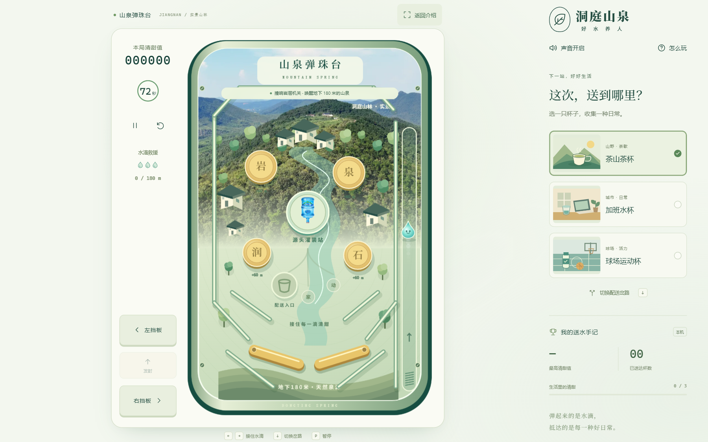
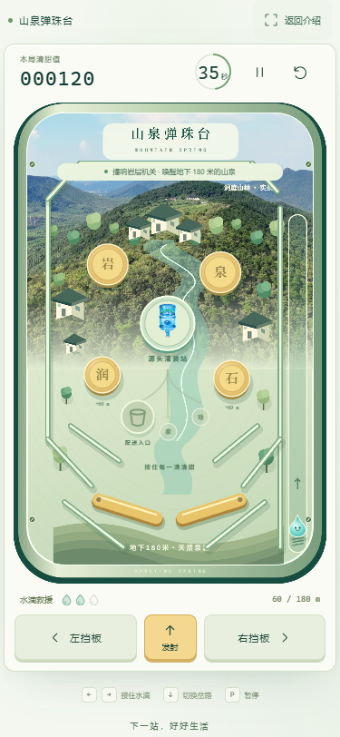
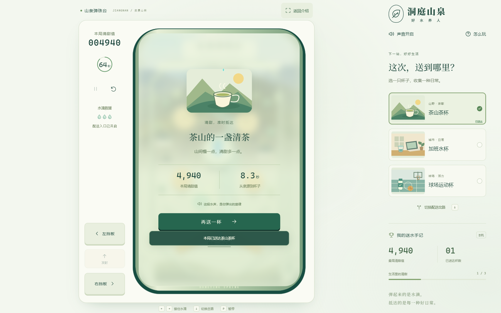

# 洞庭山泉 · 山泉弹珠台

[](https://github.com/dandan1232/WaytoAGI-MountainSpringPinball-games/actions/workflows/check.yml)
[](LICENSE)

一个以江南山城为背景的浏览器弹珠小游戏。操控一滴来自地下 180 米的山泉，穿过岩层机关、源头灌装站和配送岔路，将它送入生活中的杯子。

**[在线游玩](https://mountain-spring-pinball.vercel.app)** · [界面预览](#界面预览) · [快速开始](#快速开始) · [项目文档](#项目文档) · [许可证](#许可证)

## 界面预览

以下为当前版本的实际浏览器截图。

### 桌面端

球台保持原始比例，分数、计时和操作按钮放在侧边，右侧可选择配送目的地。



### 手机端

球台接近屏幕全宽，左右挡板与发射按钮位于下方，支持同时按住两侧挡板。



<details>
<summary>查看通关结算画面</summary>

结算展示本局分数、送达耗时与目的地。点击另一只杯子可立即切换本局场景，无需重新游玩。



</details>

## 主要功能

- **三阶段旅程**：撞响岩层完成 180 米出泉，再击中灌装站，最后进入配送入口；一局最长 72 秒。
- **弹珠物理**：重力、圆形机关、斜轨碰撞和左右挡板，提供 3 次掉落救援。
- **三种生活场景**：茶山茶杯、加班水杯、球场运动杯，可在游玩中切换路线，或在结算后立即切换本局展示。
- **真实品牌素材**：主球台使用实景山林照片，灌装站使用实际商品图；村落、轨道和水滴由 Canvas / SVG 绘制。
- **水声与纪录**：碰撞生成音符，进杯时组成水声旋律；最高分、最快用时、杯子收集与静音偏好保存在本机。
- **桌面与触摸操作**：画面等比缩放，支持放大模式、后台自动暂停、键盘操作和减少动态效果设置。

## 游戏玩法

1. 点击「开始送水」或按空格发射水滴。
2. 击中金色岩层机关，每次上升 60 米；累计 180 米后，中央源头灌装站亮起。
3. 击中灌装站，开启配送入口。
4. 选择目的地，让水滴进入对应的发光入口，完成本局送达。

掉落后点击「发射」继续。用尽 3 次救援，或达到 72 秒上限，本局结束，可立即重玩。

| 操作 | 键盘 | 屏幕按钮 |
| --- | --- | --- |
| 开始 / 发射 | `Space` | 开始送水 / 发射 |
| 左挡板 | `←` / `A` | 左挡板 |
| 右挡板 | `→` / `D` | 右挡板 |
| 切换目的地 | `↓` / `S` | 配送场景卡片 / 切换配送岔路 |
| 暂停 / 继续 | `P` / `Esc` | 暂停 / 继续送水 |

结算后切换杯子时，本局分数、耗时和已送达杯数保持不变。最高分与收集纪录只保存在当前浏览器，不跨设备同步。

## 快速开始

### 环境要求

- Node.js 22.12 或更新版本。
- npm；依赖版本由 `package-lock.json` 锁定。
- 支持 Canvas 2D 与 Web Audio 的现代浏览器。

### 安装与启动

```bash
git clone https://github.com/dandan1232/WaytoAGI-MountainSpringPinball-games.git
cd WaytoAGI-MountainSpringPinball-games
npm ci
npm run dev
```

打开终端打印的本地地址。项目为纯前端应用，无需配置环境变量、数据库或后端服务。

### 常用命令

| 命令 | 用途 |
| --- | --- |
| `npm run dev` | 启动本地开发服务器 |
| `npm run check` | 检查 TypeScript 类型 |
| `npm test` | 运行自动化测试 |
| `npm run build` | 检查类型并生成 `dist/` |
| `npm run preview` | 预览已生成的生产构建 |

## 技术与结构

游戏采用 **TypeScript + Vite + Canvas 2D + Web Audio**。物理模拟使用固定时间步进，渲染与状态管理分离；界面和操作按钮使用 HTML / CSS。

```text
.
├── src/
│   ├── main.ts                 # 界面、输入与生命周期
│   ├── style.css               # 响应式布局与交互样式
│   └── game/
│       ├── model.ts            # 关卡、计时、分数与状态机
│       ├── physics.ts          # 碰撞与挡板模拟
│       ├── renderer.ts         # 球台、山林、水滴与粒子
│       ├── viewport.ts         # 等比缩放与像素适配
│       ├── audio.ts            # 碰撞音与水声旋律
│       └── storage.ts          # 本机纪录与设置
├── public/brand/               # 本地品牌素材及来源说明
├── docs/                       # 需求、架构、设计与验收文档
│   └── screenshots/            # README 使用的实际截图
├── tests/                      # 逻辑测试与浏览器验收脚本
├── .github/workflows/check.yml # 自动检查与构建
├── vercel.json                 # Vercel 部署配置
└── LICENSE                     # MIT 许可证
```

## 测试与验证

```bash
npm run check
npm test
npm run build
```

自动化测试覆盖关卡顺序、碰撞、计时、暂停、救援、路线可达性、本机纪录，以及 Windows 不同显示缩放下的画布适配。

浏览器验收脚本位于 `tests/`，通过 agent-browser 在已打开的游戏页面执行：

- `browser-smoke.js`：完整送达流程、暂停、规则说明与声音设置。
- `current-cup-smoke.js`：完成一局后，验证杯子切换立即更新本局场景且不会重复计数。
- `viewport-smoke.js`：验证画布原始比例、横向溢出、球台与按钮可见性。

详细结果和验证范围见[验收记录](docs/ACCEPTANCE.md)。

## 部署

项目已部署在 Vercel，并连接本仓库；推送 `main` 后会自动构建和发布。

在自己的 Vercel 账号中复用时，导入仓库并使用以下配置，或通过 CLI 部署：

| 配置项 | 值 |
| --- | --- |
| Framework Preset | Vite |
| Build Command | `npm run build` |
| Output Directory | `dist` |

```bash
npx vercel login
npx vercel --prod
```

部署配置见 [`vercel.json`](vercel.json)。GitHub Actions 在推送 `main` 和创建 Pull Request 时运行类型检查、测试与生产构建。

## 项目文档

- [需求文档](docs/REQUIREMENTS.md)
- [架构文档](docs/ARCHITECTURE.md)
- [视觉与交互方案](docs/DESIGN.md)
- [验收与部署记录](docs/ACCEPTANCE.md)
- [品牌素材来源](public/brand/README.md)

## 许可证

项目代码采用 [MIT License](LICENSE)，Copyright © 2026 dandan1232。

品牌名称、标识、商品图片和山林照片的权利归各自权利人所有，MIT 许可证不改变这些素材的权利归属；来源见[品牌素材说明](public/brand/README.md)。截图包含上述品牌素材。

本项目为品牌互动概念作品，游戏中的旅程时间为创意压缩，实际配送以服务情况为准。
